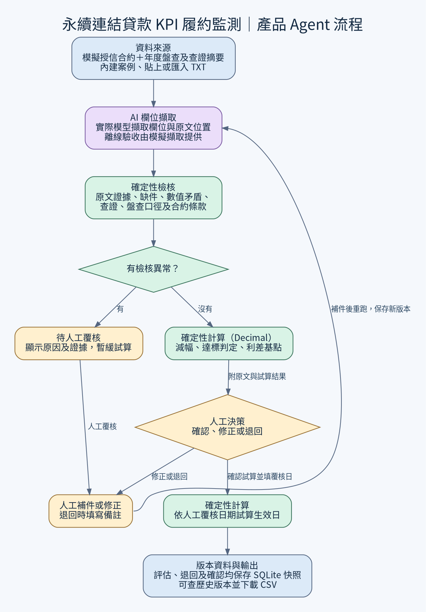

# 任務三｜運用 AI Agent 完成開發

本案為銀行貸後管理的「永續連結貸款 KPI 履約監測」PoC。開發過程中，Codex 產生及修改程式、執行測試與整理測試證據。產品執行時，案件處理流程依擷取結果選擇下一步。

## 一、開發 Agent 的實質紀錄

以下按本專案對話的實際工作回合回溯整理。

| 回合 | 提示或問題 | Codex 的操作與實質影響 | 查核證據 |
|---|---|---|---|
| 1．AI 任務 | 將授信合約與盤查摘要轉成可由老師實際操作的案件流程 | 建立本機網頁與案件 Agent。將缺件檢核及 Decimal 利差試算拆為兩個工具，依情況執行計算或轉人工。接上覆核、SQLite 快照及 CSV。 | `app.py` 的 `run_agent()`、`check()`、`calculate()`、`save()` 及 `do_POST()`。HTTP 測試通過六種示範案件、退回修正與匯出。 |
| 2．技術建議 | 降低老師啟動與資料匯入門檻 | 加入雙平台啟動檔、UTF-8 TXT 匯入及原稿保護。將模擬模式標記保留至結果頁與 CSV。用 Chromium 驗證四種錯誤檔案和含 UTF-8 BOM 的有效文字。 | `start-windows.bat`、`start-mac.command`、`app.py` 的 `FORM_SCRIPT` 及 `MODE_LABELS`。四類錯誤為副檔名、超過大小、空白內容及非 UTF-8。 |
| 3．實作驗收 | 保留好操作的教師路徑，並提供可以重跑的 20 個案例 | 使用 seed=42 生成 5 個開發案件與 20 個獨立驗收案件，每案有兩年度資料。建立標準答案、固定欄名基準、端對端測試及逐案報告。解壓 ZIP 測試時發現檔案沒有保留 sll 目錄，修正打包路徑，再驗證資料可重建且測試通過。 | `generate_samples.py`、`samples_dev.json`、`samples_test.json`、`verify.py`、`驗收報告.md`、`驗收明細.json`。模擬狀態一致 20/20、異常正確分流 11/11。 |

## 二、產品 Agent 的可執行流程

| 類型 | 職責與實作 |
|---|---|
| 資料來源 | 模擬授信合約提供門檻、查證要求、利差及生效條件。年度盤查及查證摘要提供評估年度、排放量、盤查邊界及查證狀態。 |
| AI 欄位擷取 | `extract()` 在實際模型模式呼叫模型取得欄位、值及來源行號，再由程式檢查引文是否存在。離線流程以標示為 `[MOCK MODE]` 的規則式擷取走同一條流程。 |
| 確定性檢核與計算 | `run_agent()` 先呼叫 `check()`。有缺漏、矛盾、重編、必要查證缺件等異常時，回傳待人工覆核；無異常時才呼叫 `calculate()`，以 Decimal 試算排放減幅及合約利差。 |
| 人工決策 | 承辦人確認試算並輸入覆核日期，或填寫退回原因、補件修正後重跑。程式依覆核日期計算生效日，將各版本寫入 SQLite。正式調息屬銀行授權流程。 |

### 示範與本次重跑結果

1. 首頁選「正常達標」並執行。工具紀錄顯示擷取、檢核及利差試算；結果為減幅 **11%**、達標及 **−5 bps**。輸入覆核日期 **2026-06-15** 並確認，生效日為 **2026-07-01**。原文證據包含「盤查及查證摘要 第 2 行：年度排放量：8900」。
2. 首頁選「缺查證」並執行。工具紀錄顯示缺件檢核後轉人工覆核，利差結果留空。承辦人退回並填備註，補齊查證後重跑，再確認與匯出。舊版本仍可查閱。
3. 在專案目錄執行 `python verify.py` 可重跑。此回合通過 20 個獨立合成案例及 HTTP 端對端檢查，涵蓋退回、修正、確認、CSV 與舊版查閱。

真實模型擷取入口已實作。本次使用模擬擷取驗證產品 Agent 的整條流程，尚未以實際模型驗證欄位擷取品質。案件分流由伺服器依工具檢核結果執行。
